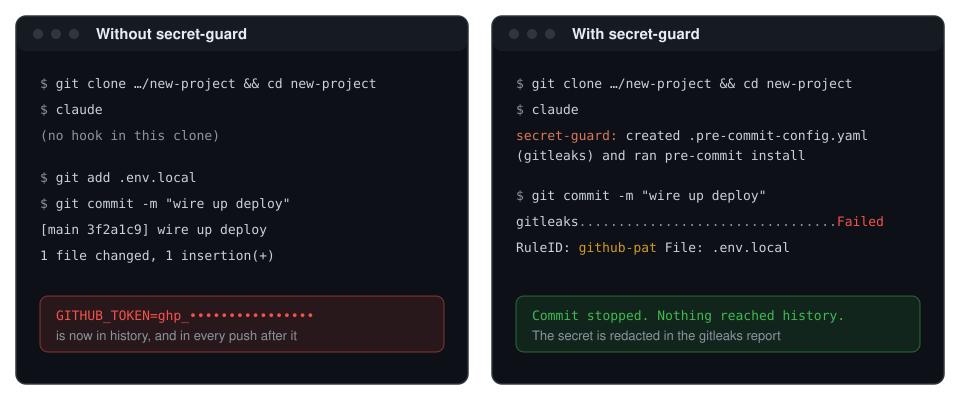

# secret-guard

<p align="center">
  <strong>Secrets stop at the commit.</strong><br>
  A Claude Code mod that adds a gitleaks pre-commit hook to each Git project you open.
</p>

<p align="center">
  <a href="CHANGELOG.md"></a>
  <a href="LICENSE"></a>
  <a href="https://code.claude.com/docs"></a>
  <a href="hooks/register.ts"></a>
  <a href="tests/guard.test.ts"></a>
</p>

<p align="center">
  <a href="#features">Features</a> ·
  <a href="#install">Install</a> ·
  <a href="#usage">Usage</a> ·
  <a href="#configuration">Configuration</a> ·
  <a href="#development">Development</a> ·
  <a href="CONTRIBUTING.md">Contributing</a> ·
  <a href="CHANGELOG.md">Changelog</a>
</p>



*Illustration of a commit before and after.*

Installing `gitleaks` and a hook manager on your machine does not protect a repository until that repository has a hook config and someone installs the hook. On a fresh clone, that step is easy to forget. secret-guard does it for you: when a Claude Code session starts in a Git project, it checks for a gitleaks pre-commit hook and adds one if it is missing. From then on, a commit that contains an API key, token or private key stops before it reaches history.

| | |
| --- | --- |
| **Runs** | When a session starts, and when Claude enters a worktree |
| **Needs** | `gitleaks`, plus pre-commit or Lefthook (Husky for JS/TS projects that use it) |
| **Writes** | `.pre-commit-config.yaml`, `lefthook.yml`, or `.husky/pre-commit` |
| **Never** | Rewrites an existing config, or adds dependencies unless you opt in |

> [!NOTE]
> secret-guard is built on Claude Code's function-hooks mod API, which is in early access and may change between releases.

## Features

- **Set up once per project:** A project that already has a gitleaks hook is left alone, and the check never delays your first prompt.
- **pre-commit or Lefthook:** Writes a `.pre-commit-config.yaml` or a `lefthook.yml` that runs your installed `gitleaks`, then installs the hook. A project keeps the manager its config already uses, in any file name and format Lefthook reads.
- **Husky for JS/TS:** Puts the gitleaks step at the top of `.husky/pre-commit` in projects that use Husky. A JS/TS project without Husky gets Lefthook when it is installed, so no dependency is added.
- **One manager, your pick:** When both pre-commit and Lefthook are installed, secret-guard asks you to pick one with `/secret-guard-use`, switches the projects it set up, and can remove the other.
- **Worktrees work too:** A worktree shares the repository's installed hook but not an uncommitted config. Its commits would be blocked (pre-commit) or skip the scan (Lefthook), so secret-guard adds the config there and reminds you to commit it.
- **Respects your setup:** An existing config without gitleaks, or a `core.hooksPath` set by another tool, gets a notice instead of a change.
- **No surprise dependencies:** Husky is added to `package.json` only when you turn on `autoInstallHusky`, and a `prepare` script it adds is `husky || true`.

| Project | What secret-guard does |
| --- | --- |
| Not a Git repository, or `gitleaks` not installed | Nothing |
| No hook config | Creates `.pre-commit-config.yaml` or `lefthook.yml` (your pick, else pre-commit) and installs the hook |
| Config with gitleaks, hook not installed | Installs the hook |
| Hook installed but no config, as in a new worktree | Creates the config |
| Set up, but the config is not committed | Shows a notice with the `git add` command |
| Config without gitleaks | Shows a notice and leaves the file as it is |
| Both `lefthook.yml` and `.pre-commit-config.yaml` | Uses your pick and says which file to delete |
| `package.json` with Husky | Adds gitleaks to `.husky/pre-commit` and turns Husky on |
| `package.json` without Husky | Uses Lefthook if installed, else shows the Husky install command (or installs it with `autoInstallHusky`) |

## Install

Install gitleaks and one hook manager:

```bash
brew install gitleaks pre-commit
```

Or, for Lefthook instead of pre-commit:

```bash
brew install gitleaks lefthook
```

Then, in a Claude Code **terminal** session, run:

```
/plugin install secret-guard --marketplace AnnihilationWizard/secret-guard
```

1. Answer `y` to add the `github:AnnihilationWizard/secret-guard` marketplace.
2. Choose a scope. The **user** scope loads the mod in every session.
3. Claude Code confirms `Installed secret-guard. Plugin is now active.` The check runs in each session started after that.

To update later, run `claude plugin update`, then `/reload-plugins`.

<details>
<summary>Run from a local clone instead</summary>

```bash
git clone https://github.com/AnnihilationWizard/secret-guard.git
claude --plugin-dir ./secret-guard
```

To load a clone in every session, add it to the `env` block of `~/.claude/settings.json`:

```json
{
  "env": { "CLAUDE_CODE_PLUGIN_DIRS": "/path/to/secret-guard" }
}
```

</details>

## Usage

Start Claude Code in a Git project. If the project has no gitleaks hook, a notice says what secret-guard added. Then commit as usual. When gitleaks finds a secret in the staged changes, the commit stops and gitleaks prints the file, line and rule, with the secret redacted.

| Command | Effect |
| --- | --- |
| `/secret-guard-use lefthook` | Use Lefthook from now on and switch this project if secret-guard set it up with pre-commit |
| `/secret-guard-use pre-commit` | The same, the other way round |
| `/secret-guard-use <manager> --remove-other` | Also uninstall the other manager: with Homebrew when it was installed that way, otherwise it says how |

Without `--remove-other`, nothing is uninstalled: the command first says which repositories could be affected, so you can switch them before removing anything.

The configs secret-guard writes:

```yaml
# .pre-commit-config.yaml
repos:
  - repo: local
    hooks:
      - id: gitleaks
        name: gitleaks
        entry: gitleaks git --pre-commit --redact --staged --verbose
        language: system
        pass_filenames: false
```

```yaml
# lefthook.yml
pre-commit:
  commands:
    gitleaks:
      run: gitleaks git --pre-commit --redact --staged --verbose
```

With gitleaks older than 8.19, the command is `gitleaks protect --staged --redact --verbose`.

To allow a false positive, add its fingerprint to a `.gitleaksignore` file in the project, or set an allowlist in `.gitleaks.toml`.

## Configuration

| Option | Default | Effect |
| --- | --- | --- |
| `autoInstallHusky` | `false` | In a JS/TS project without Husky, adds it as a dev dependency with the package manager the lockfile points to: pnpm, yarn, bun or npm. Changes `package.json` and the lockfile. |

Change it from the `/config` menu, or in `~/.claude/settings.json`:

```json
{
  "pluginConfigs": {
    "secret-guard@secret-guard": {
      "options": { "autoInstallHusky": true }
    }
  }
}
```

In a pnpm workspace root, secret-guard installs with `pnpm add -w`. The pick from `/secret-guard-use` is kept across sessions.

### Limitations

- secret-guard sets up every Git project you open, including repositories you cloned only to read. Each project is set up once, and a notice names the change.
- A worktree is checked when a session starts in it or Claude enters it with EnterWorktree. Moving into one with a shell `cd` is not detected; commit the config once and every worktree has it.
- Only configs secret-guard wrote are switched to the other manager. A project's own config keeps its manager.
- Teammates need `gitleaks` and the same hook manager.
- Husky sets `core.hooksPath`, so hooks in `.git/hooks` stop running in that project, and pre-commit or Lefthook cannot install there.
- Yarn Plug'n'Play projects have no `node_modules/husky`. secret-guard writes the hook and asks you to turn Husky on.
- On Windows, a project folder whose path is longer than about 260 characters stops commands from starting there. secret-guard shows a notice that the project is not protected; move it to a shorter path.
- The `/plugin install` command is available in terminal sessions only. A user-scope install also loads in the desktop app's Code tab.

## Development

```bash
claude plugin validate .   # manifest, marketplace file and hooks module
claude plugin test .       # tests/*.test.ts against the engine
```

After Claude Code first loads the mod, it writes the API types to `.claude-plugin/types/` (git-ignored). Type-check against them with TypeScript 5.4 or newer:

```bash
npx -p typescript@5 tsc -p .
```

Run `claude --plugin-dir .` to try changes. In an interactive session the folder is watched, and saving a file reloads the mod.

## Project Structure

```text
.claude-plugin/   plugin.json manifest and marketplace.json
hooks/            hooks.json, the session hooks, /secret-guard-use and the setup logic
tests/            tests for the setup logic
docs/images/      README illustration
```

## Contributing

Bug reports and ideas are welcome. Read [CONTRIBUTING.md](CONTRIBUTING.md) before opening an [issue](https://github.com/AnnihilationWizard/secret-guard/issues) or pull request, and follow [SECURITY.md](SECURITY.md) for security reports.

## License

[MIT License](LICENSE). Copyright © 2026 [AnnihilationWizard](https://github.com/AnnihilationWizard).
